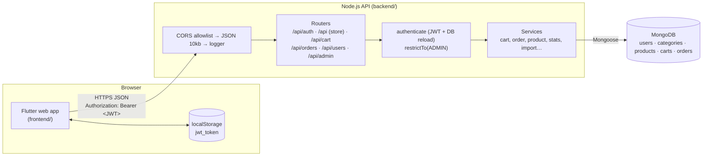
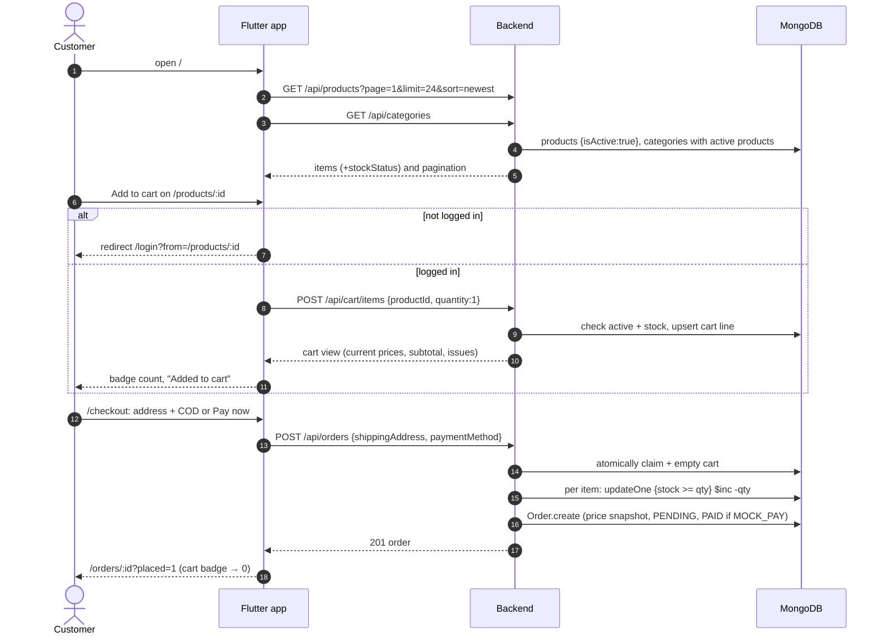
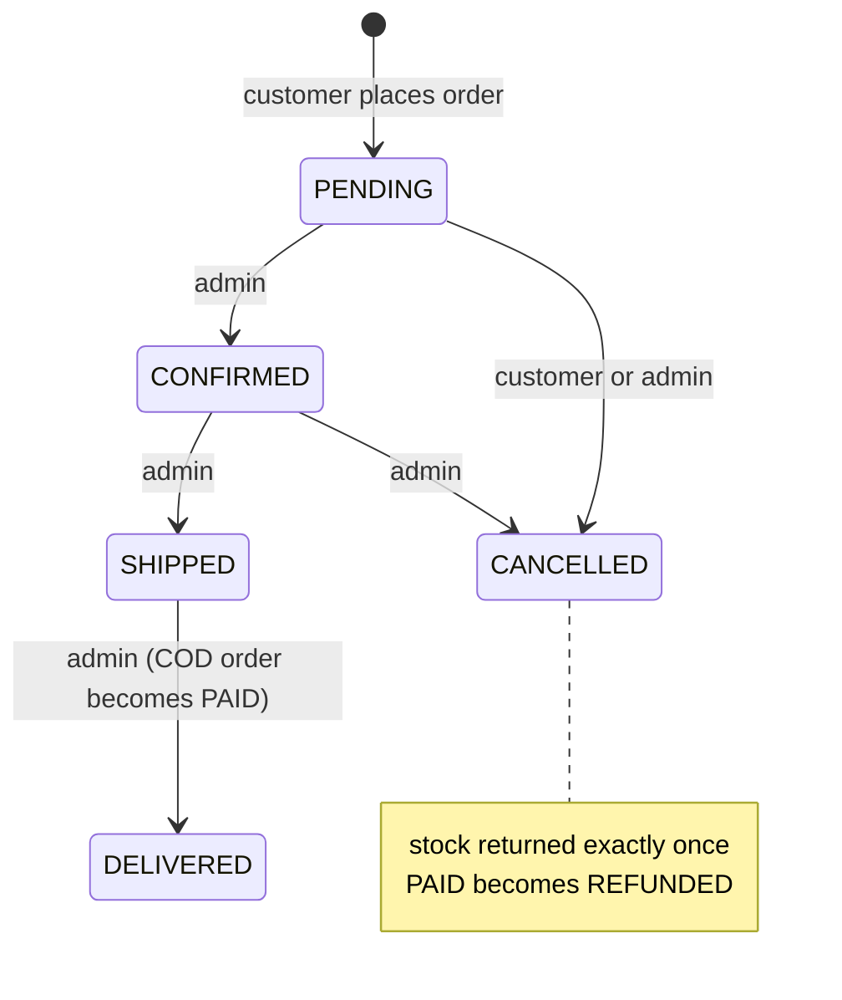
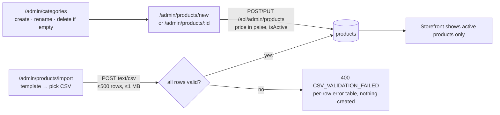

# ShopKart

ShopKart is a single-store e-commerce app:

- **Customers** browse and search a catalog, keep a server-side cart, check out with **Cash on Delivery** or a **mock "Pay now"**, and track or cancel their orders.
- **Admins** use the same app to manage categories, products, stock (including CSV bulk import), orders and user accounts, and to see a sales dashboard.

**Core value:** a customer can find a product, put it in the cart and place an order that an admin can move through to delivery, with **prices, totals and stock always computed on the server**.

| Part | Stack | Docs |
|------|-------|------|
| [`backend/`](backend/) | Node.js 24 · TypeScript · Express 5 · MongoDB/Mongoose · JWT · zod | **[backend/README.md](backend/README.md)** |
| [`frontend/`](frontend/) | Flutter web · flutter_bloc · Dio · go_router · get_it · shared_preferences | **[frontend/README.md](frontend/README.md)** |

---

## Demo videos

Both videos play inline on GitLab. Under each one is a direct link for viewers that do not render video.

### Customer and admin walkthrough


[Open shopkart.mp4](shopkart.mp4) (1:43)

- Storefront home, **search**, **category filter** and **sort by price**.
- Product detail: **Add to cart** while logged out redirects to login; a new customer **signs up** and returns to the product.
- **Cart** quantity change, then **checkout** with a shipping address and **Cash on Delivery**; the order confirmation shows a progress tracker.
- **My orders** and **Profile**, then log out.
- **Admin** logs in, opens the dashboard, filters orders by Pending and moves the order **Confirmed → Shipped → Delivered**; also creates a product, and visits categories and users search.
- The new product shows up in storefront search, and the customer logs back in to see the order **Delivered** and **Paid**.

### Admin tour


[Open shopkart-admin.mp4](shopkart-admin.mp4) (1:41, with on-screen captions)

- **Dashboard** analytics: paid revenue, total orders and counts per status.
- **Low-stock** panel (active products with stock at or below 5) and **recent orders** panel (5 latest, click opens the order); a low-stock item opens its product edit form.
- **Categories**: create "Home Decor", then rename it to "Home & Living".
- **Products**: create "Woven Cotton Throw" (₹1,299, stock 3, flagged low), then edit it (₹999, restocked to 40).
- **Users**: search, promote a customer to **Admin** via Actions → Make admin, then demote with Make user (confirm dialog).
- Back on the dashboard, **Refresh** shows the updated analytics.

---

## Contents

- [Demo videos](#demo-videos)
- [Project status](#project-status)
- [Repository layout](#repository-layout)
- [System architecture](#system-architecture)
- [How frontend and backend communicate](#how-frontend-and-backend-communicate)
- [Authentication and roles](#authentication-and-roles)
- [Major user flows](#major-user-flows)
- [Database interactions](#database-interactions)
- [Environment setup](#environment-setup)
- [Local startup](#local-startup)
- [Deployment](#deployment)
- [Troubleshooting](#troubleshooting)

---

## Project status

The project is planned in 8 vertical phases. Each phase delivers API work plus the screens that use it.

| Phase | Scope | Status |
|-------|-------|--------|
| 1 Foundation & Auth | Signup/login/session restore, roles, seed admin | ✅ Implemented |
| 2 Admin Catalog | Categories, products, soft delete, name thumbnails, CSV import | ✅ Implemented |
| 3 Storefront | Public grid, filter, search, sort, pagination, detail | ✅ Implemented |
| 4 Cart | Server-side cart, stock-checked quantities, badge | ✅ Implemented |
| 5 Checkout & My Orders | Address + COD/mock pay, atomic stock decrement, history, cancel, profile | ✅ Implemented |
| 6 Admin Orders & Users | Status workflow, role change, block/unblock | ✅ Implemented |
| 7 Admin Dashboard | Paid revenue, counts by status, low stock, recent orders | ✅ Implemented (manual UI walk-through still marked pending in the local planning docs) |
| 8 Deployment | GitHub Actions → Render + GitHub Pages | ❌ **Not started.** No workflow, Pages config or `DEPLOYMENT.md` in the repo |

There are **no automated tests by design** (see [CLAUDE.md](CLAUDE.md)). The current code passes `npm run typecheck` (backend) and `flutter analyze` (frontend).

---

## Repository layout

```text
shopkart/
├── README.md            ← you are here
├── CLAUDE.md            # project constraints and conventions for AI-assisted work
├── backend/             # Express + MongoDB API          → backend/README.md
│   ├── .env.example
│   └── src/{routes,controllers,service,models,middlewares,validation,utils,scripts,config}
└── frontend/            # Flutter web client             → frontend/README.md
    ├── web/
    └── lib/{core,bloc,models,repositories,presentation}
```

`.planning/` (requirements, roadmap, phase plans, reviews) is **gitignored** and only exists in the author's local checkout. It is referenced below as a source, but it is not part of the published repository.

---

## System architecture



| Concern | Where it lives |
|---------|----------------|
| Prices, subtotals, totals, stock checks, stock status | Backend only. The app displays server values. |
| Admin authorisation | Backend router gate on every `/api/admin/*`. The Flutter guard only hides screens. |
| Session | Stateless JWT, stored in the browser. The backend re-reads the user's role and blocked flag on every request. |
| Configuration | Backend: `backend/.env`. Frontend: the `API_BASE_URL` compile-time define (no hard-coded host). |

---

## How frontend and backend communicate

- **Transport.** REST over HTTP(S) with JSON bodies. The one exception is CSV import, which sends `text/csv`.
- **Base URL.** The app is started or built with `--dart-define=API_BASE_URL=<host>/api`, which has no default. Every repository path is relative to it, such as `/products` and `/cart/items`.
- **Auth header.** A Dio interceptor adds `Authorization: Bearer <jwt_token>` to every request except login and signup. The API never uses cookies.
- **Response envelope:**

  ```json
  { "success": true,  "data": { … }, "message": "optional" }
  { "success": false, "message": "Only 1 left of \"Mug\"", "code": "INSUFFICIENT_STOCK", "errors": [ … ] }
  ```

  The app turns every failure into an `ApiException(message, statusCode, code, details)` and mostly shows `message` directly. A few codes drive behaviour: `INSUFFICIENT_STOCK`, `ITEM_UNAVAILABLE` and `CART_EMPTY` reload the cart, and `CSV_VALIDATION_FAILED` renders a per-row error table.
- **Session end.** A `401`, or a `403` with `ACCOUNT_BLOCKED`, on any request that carried a token makes the app delete the token and route to `/login`.
- **CORS.** The API only answers browsers whose `Origin` is listed in `CORS_ORIGINS` (default `http://localhost:3000`), and `*` is refused at startup. That is why the Flutter dev server runs on `--web-port 3000`.
- **Money.** Every amount on the wire is an **integer number of paise**. The app formats it as `₹1,299.00`. Admins type rupees in the product form and in CSV files, and those are converted to paise with integer maths.

Endpoint details: [backend API reference](backend/README.md#api-reference) · client side: [frontend repositories](frontend/README.md#repositories-api-services).

---

## Authentication and roles

| Topic | Behaviour |
|-------|-----------|
| Roles | `USER` (customer) and `ADMIN`. Public signup **always** creates `USER`, and any `role` in the body is ignored. |
| First admin | `npm run seed:admin`, which reads `ADMIN_NAME/EMAIL/PASSWORD` from env. It is idempotent and never changes an existing account. |
| Token | HS256 JWT containing only `{ userId }`, valid for `JWT_EXPIRES_IN` (default `7d`). |
| Per-request check | `authenticate` reloads the user from MongoDB. A deleted user gets `401` and a blocked user gets `403 ACCOUNT_BLOCKED`, **even with a valid token**. |
| Admin check | `restrictTo(ADMIN)` covers all `/api/admin/*` routes. A non-admin gets `403 FORBIDDEN`. |
| Session restore | On app start, `AuthBloc` calls `GET /api/auth/me` with the stored token. A network error or 5xx keeps the token and offers Retry, which handles cold starts. |
| Logout | Client deletes the token. The server endpoint is a no-op, so the JWT is not revoked. |
| Self-protection | An admin cannot demote or block themselves. |

Full detail: [backend auth](backend/README.md#authentication-and-authorisation) · [frontend auth flow](frontend/README.md#authentication-flow).

---

## Major user flows

### 1. Browse → cart → checkout → order (customer)



If any item is short or inactive, nothing is decremented (earlier lines are rolled back). The cart is restored and the user sees which item failed, for example `Only 1 left of "Mug"`.

### 2. Order fulfilment (admin) and cancellation



The admin opens `/admin/orders`, filters by status, and opens an order. The screen only shows buttons for the allowed next steps, and the server rejects any other transition with `409 INVALID_STATUS_TRANSITION`.

### 3. Catalog management (admin)



### 4. Account management

- **Customer:** `/profile` to view the account, change the name, or change the password (the current password is required).
- **Admin:** `/admin/users` to search, create users with a role, Make admin / Make user, and Block / Unblock. A blocked user is logged out on their next request and can't log in again.

### 5. Dashboard

`/admin` loads `GET /api/admin/stats`:

- Paid revenue (`paymentStatus: PAID` only).
- Order counts per status.
- Active products with stock ≤ 5 (up to 10 listed, each linking to its edit form).
- The 5 latest orders, each linking to its admin detail.

---

## Database interactions

| Collection | Written by | Important rules |
|------------|-----------|-----------------|
| `users` | signup, seed script, admin create/role/block, profile | `email` unique and lowercased. `passwordHash` (bcrypt cost 12) is never selected by default. |
| `categories` | admin | `nameKey` (lowercase name) is unique. A category can't be deleted while it has any product. |
| `products` | admin form, CSV import, order placement / cancel (`stock` only) | `price` is an integer in paise. Stock decrements are **conditional** (`stock >= qty`), so there is no overselling. Deactivating sets `isActive: false` (no hard delete). |
| `carts` | cart endpoints, order placement | One per user. Holds only `{product, quantity}`, and prices are looked up live. |
| `orders` | order placement, customer cancel, admin status change | Items snapshot name, image and unit price. Each order has a `statusHistory` and a `restocked` guard. |

MongoDB transactions are **not** used. Multi-document consistency relies on atomic conditional updates plus compensating writes. See [backend business logic](backend/README.md#business-logic) and its [ER diagram](backend/README.md#data-model).

---

## Environment setup

| Tool | Version | Notes |
|------|---------|-------|
| Node.js | **24** ([`backend/.nvmrc`](backend/.nvmrc)), `engines >= 20.19.0` | |
| MongoDB | local `mongod` or an Atlas URI | Default dev URI `mongodb://127.0.0.1:27017/shopkart_db` |
| Flutter | Dart SDK `^3.13.2` | Chrome for `flutter run -d chrome` |

Backend env: copy [`backend/.env.example`](backend/.env.example) to `backend/.env`.

| Variable | Purpose |
|----------|---------|
| `PORT` | API port (default 5000) |
| `NODE_ENV` | `production` disables all dev fallbacks |
| `MONGODB_URI` | Database (required in production) |
| `JWT_SECRET` | Token signing secret (required in production; **set it locally too**, e.g. `openssl rand -hex 32`) |
| `JWT_EXPIRES_IN` | Token lifetime (default `7d`) |
| `CORS_ORIGINS` | Comma-separated exact browser origins, no `*` |
| `ADMIN_NAME`, `ADMIN_EMAIL`, `ADMIN_PASSWORD` | Only for `npm run seed:admin` |

Frontend config: the single build-time define `API_BASE_URL`, for example `http://localhost:5000/api`.

Never commit `backend/.env` or real admin credentials.

---

## Local startup

```bash
# 1. API
cd backend
cp .env.example .env            # set JWT_SECRET (and ADMIN_* for the next step)
npm install
npm run dev                     # http://localhost:5000
curl localhost:5000/health      # {"success":true,…,"db":"connected"}

# 2. First admin (once)
npm run seed:admin

# 3. Web app (new terminal)
cd frontend
flutter pub get
flutter run -d chrome --web-port 3000 --dart-define=API_BASE_URL=http://localhost:5000/api
```

Quick manual check:

1. Log in as the seeded admin.
2. Open **Admin**, then **Categories**, and create a category.
3. Open **Products**, then **New product**.
4. Log out and sign up as a customer.
5. Add the product to the cart, then **Checkout** with COD.
6. Log back in as the admin and move the order to Delivered. The order shows as Paid, and dashboard revenue increases.

Static checks:

```bash
cd backend  && npm run typecheck
cd frontend && flutter analyze
```

---

## Deployment

> **Not implemented yet (Phase 8).** The repo contains no `.github/workflows/`, no Render configuration, no GitHub Pages setup and no `DEPLOYMENT.md`.

**Planned target** (from the local roadmap):

- A push to `main` runs a GitHub Actions workflow.
- The backend job runs `npm ci` and `tsc`, triggers a Render deploy hook, and polls until `/health` passes.
- The frontend job runs `flutter build web --dart-define=API_BASE_URL=<Render URL>/api --base-href /<repo>/`, copies `index.html` to `404.html` for deep links, and publishes to GitHub Pages.
- The database is MongoDB Atlas (free tier).

**Already in place for that:**

- The backend `build`/`start` scripts.
- `trust proxy`.
- Production fail-fast env checks.
- A CORS allowlist that refuses `*`.
- `seed:admin:prod` for compiled builds.

Manual deployment steps that work with today's code: [backend deployment](backend/README.md#deployment) and [frontend build](frontend/README.md#setup-run-and-build).

---

## Troubleshooting

| Symptom | Likely cause | Fix |
|---------|-------------|-----|
| App shows **"Configuration error"** | `API_BASE_URL` not passed | Add `--dart-define=API_BASE_URL=http://localhost:5000/api` |
| "Cannot reach the server" in the app, CORS error in the console | Web port not in `CORS_ORIGINS`, or API down | Run Flutter on `--web-port 3000`, or add your origin to `CORS_ORIGINS` and restart the API |
| API exits with `CORS_ORIGINS must list explicit origins` | `*` in `CORS_ORIGINS` | List exact origins |
| API exits with `Missing required env var …` | `NODE_ENV=production` without `MONGODB_URI` / `JWT_SECRET` | Set them |
| `/health` shows `"db":"disconnected"` | MongoDB not reachable at startup (no retry) | Start MongoDB or fix `MONGODB_URI`, then restart the API |
| `Failed to start server on port 5000` | Port in use | Stop the other process or change `PORT` (and `API_BASE_URL`) |
| Splash screen with **Retry** | `/auth/me` timed out or 5xx (for example a cold start) | Wait for the API, then Retry. The token is kept. |
| Suddenly back at `/login` | Token expired or invalid, user deleted, or user blocked | Log in again (a blocked user can't) |
| Admin area missing | Account is `USER` | `npm run seed:admin`, or have an admin change the role, then log in again |
| `409 INSUFFICIENT_STOCK` at checkout | Someone bought the stock first | Cart reloads with flags. Lower the quantity or remove the line. |
| `CATEGORY_IN_USE` on delete | Category still has products (even inactive ones) | Move the products to another category first |
| CSV import rejected | Header, row or size errors | Read the per-row table. Prices are in rupees (`499.00`) and categories must already exist. |

More: [backend troubleshooting / error codes](backend/README.md#error-codes) · [frontend debugging](frontend/README.md#debugging-and-troubleshooting).

---
# grocery-store
