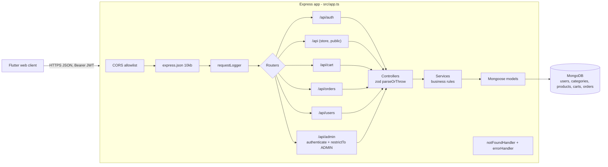
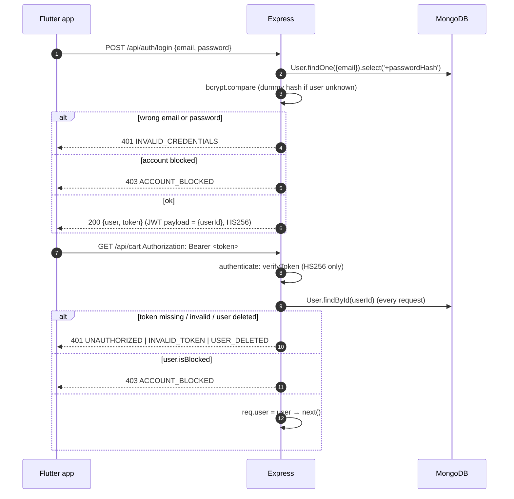
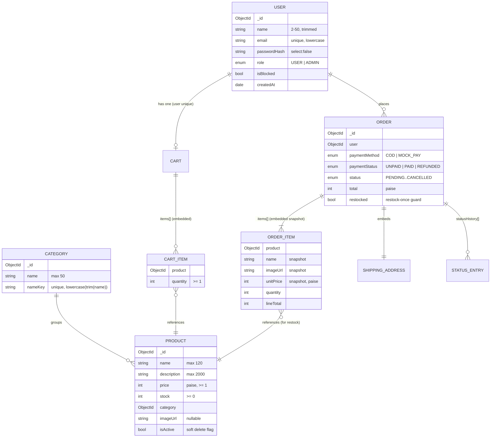
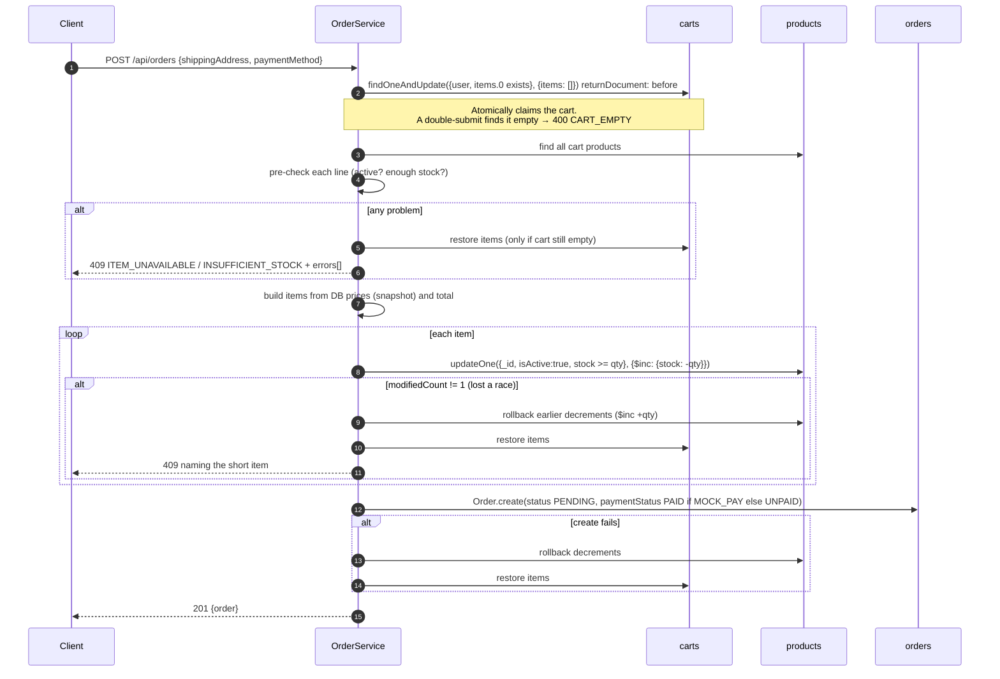
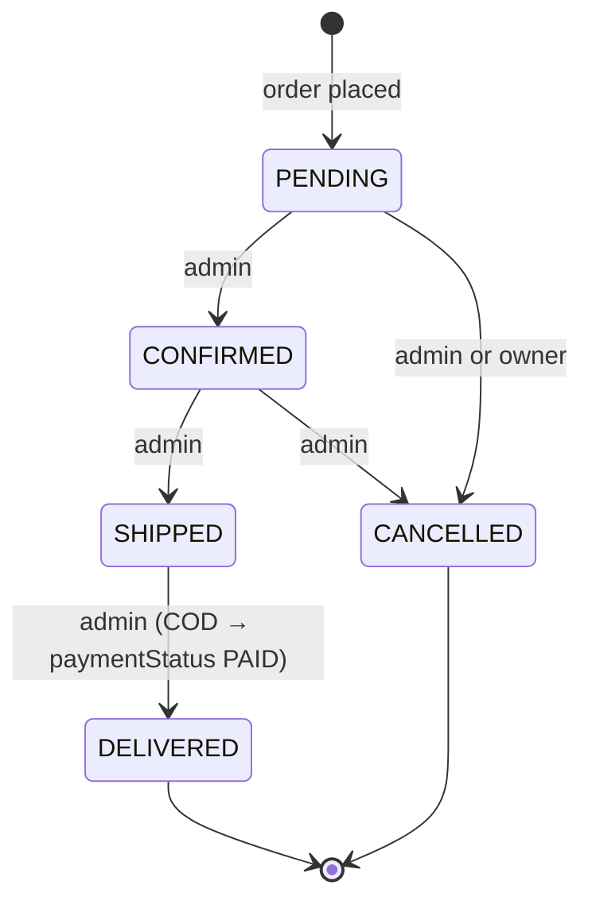

# ShopKart Backend

REST API for ShopKart, a single-store e-commerce app. It is built with Express 5, TypeScript, MongoDB (Mongoose), JWT and zod. The Flutter web client in [`../frontend`](../frontend/README.md) is its only consumer.

> Part of the ShopKart monorepo. Start at the [root README](../README.md) for the whole-system picture, and see the [frontend README](../frontend/README.md) for the client.

---

## Contents

- [At a glance](#at-a-glance)
- [Tech stack](#tech-stack)
- [Project structure](#project-structure)
- [Architecture](#architecture)
- [Request pipeline and middleware](#request-pipeline-and-middleware)
- [Authentication and authorisation](#authentication-and-authorisation)
- [Data model](#data-model)
- [Business logic](#business-logic)
- [API reference](#api-reference)
- [Error codes](#error-codes)
- [Environment variables](#environment-variables)
- [Setup and local development](#setup-and-local-development)
- [Scripts](#scripts)
- [Deployment](#deployment)

---

## At a glance

| Item | Value |
|------|-------|
| Base path | `/api` (plus `GET /health` at the root) |
| Default port | `5000` (`PORT`) |
| Auth | `Authorization: Bearer <JWT>` only (no cookies) |
| Roles | `USER`, `ADMIN` |
| Money | Integer **paise** everywhere (`129900` = ₹1,299.00) |
| JSON body limit | 10 KB (CSV import route: 1 MB `text/csv`) |
| Success envelope | `{ "success": true, "data": …, "message"?: … }` |
| Error envelope | `{ "success": false, "message": …, "code": …, "errors"?: [...] }` |
| Tests | None by design (MVP). Verification is `npm run typecheck` + curl |

---

## Tech stack

From [`package.json`](package.json):

| Package | Version | Purpose |
|---------|---------|---------|
| `express` | ^5.3.0 | HTTP server. Express 5 forwards rejected promises from async handlers to the error handler, so controllers have no `try/catch` |
| `mongoose` | ^9.11.2 | MongoDB ODM |
| `jsonwebtoken` | ^9.0.3 | HS256 JWT sign/verify |
| `bcryptjs` | ^3.0.3 | Password hashing (cost 12) |
| `zod` | ^4.6.7 | Request validation for bodies and query strings |
| `cors` | ^2.8.6 | Explicit origin allowlist |
| `dotenv` | ^18.0.8 | Loads `backend/.env` |
| `typescript` (dev) | ^7.0.2 | Compiler (`tsc`) |
| `tsx` (dev) | ^4.23.15 | Runs TypeScript directly in dev (`tsx watch`) |

Runtime: `engines.node` is `>=20.19.0`, and [`.nvmrc`](.nvmrc) pins **Node 24**.

---

## Project structure

```text
backend/
├── .env.example            # template for .env (never commit .env)
├── .nvmrc                  # Node 24
├── package.json
├── tsconfig.json           # src → dist, strict, module node16
└── src/
    ├── server.ts           # starts HTTP listener, then connects MongoDB; process guards
    ├── app.ts              # Express app: trust proxy, CORS, json, logger, /health, routers, error handlers
    ├── config/
    │   ├── env.ts          # reads + validates env (fail-fast in production)
    │   └── db.ts           # mongoose.connect
    ├── middlewares/
    │   ├── auth.middleware.ts    # authenticate: Bearer JWT → reload user → reject blocked
    │   ├── role.middleware.ts    # restrictTo(...roles)
    │   ├── error.middleware.ts   # AppError, 404 handler, global error handler
    │   └── logger.middleware.ts  # one log line per request
    ├── routes/             # URL → controller wiring (auth, store, cart, order, user, admin)
    ├── controllers/        # parse input with zod → call service → send envelope
    ├── service/            # business logic + Mongoose queries
    ├── models/             # Mongoose schemas: User, Category, Product, Cart, Order
    ├── validation/         # zod schemas + parseOrThrow + assertObjectId
    ├── utils/
    │   ├── jwt.ts          # signToken / verifyToken (HS256, payload = { userId })
    │   └── csv.ts          # RFC 4180 CSV reader/writer (no dependency)
    ├── scripts/
    │   └── seedAdmin.ts    # npm run seed:admin
    └── types/express.d.ts  # adds req.user
```

> `backend/docs/` is gitignored ([`.gitignore`](.gitignore)). It holds local learning notes, not project documentation.

---

## Architecture

The code is layered as **routes → controllers → services → models**. Each layer only talks to the one below it.



| Layer | Responsibility | Example |
|-------|----------------|---------|
| Route | Mounts handlers and middleware on paths | [`routes/admin.routes.ts`](src/routes/admin.routes.ts) applies `authenticate, restrictTo(ADMIN)` to every admin path |
| Controller | Validates `req.body`/`req.query` with zod, takes the user id from `req.user` (never from the body), sends the response envelope | [`controllers/order.controller.ts`](src/controllers/order.controller.ts) |
| Service | Business rules, stock/price maths, atomic updates, mapping documents to public views | [`service/order.service.ts`](src/service/order.service.ts) |
| Model | Schema, validation, indexes, enums, shared constants | [`models/product.model.ts`](src/models/product.model.ts) (`LOW_STOCK_THRESHOLD = 5`) |

Services return plain **view objects** (`toPublic`, `toView`, `toSummary`, `toStore`). Raw Mongoose documents never reach the client, so `passwordHash`, `_id` and `__v` are not exposed. Product `isActive`/`updatedAt` are also hidden from the public storefront.

---

## Request pipeline and middleware

Order of registration in [`src/app.ts`](src/app.ts):

1. `app.set('trust proxy', 1)`: trusts the first proxy hop (intended for Render's HTTPS proxy).
2. **CORS** ([`cors`](https://www.npmjs.com/package/cors)): the origin must appear in `CORS_ORIGINS`. Requests **without** an `Origin` header (curl, server-to-server) are allowed. Allowed methods are `GET, POST, PUT, PATCH, DELETE, OPTIONS` and allowed headers are `Content-Type, Authorization`. A disallowed origin gets no `Access-Control-Allow-Origin` header, so the browser blocks the response.
3. `express.json({ limit: '10kb' })`.
4. `requestLogger`: logs `[ISO time] METHOD URL` for every request.
5. `GET /health`.
6. Routers: `/api/auth`, `/api/admin`, `/api/cart`, `/api/orders`, `/api/users`, then `/api` (store).
7. `notFoundHandler` → `404 NOT_FOUND`.
8. `errorHandler` (global).

### Error handler

[`middlewares/error.middleware.ts`](src/middlewares/error.middleware.ts):

- **`AppError(message, statusCode, code, details?)`** is the only error type whose message reaches the client. If `details` is set, it is returned as `errors`.
- body-parser errors (they carry a `type`, such as invalid JSON) are also passed through as-is. `entity.too.large` becomes `PAYLOAD_TOO_LARGE` with a readable limit ("10 KB" / "1 MB").
- Anything else becomes `500 INTERNAL_SERVER_ERROR` with the message `"Something went wrong on the server"`, and the real error is logged.
- When `NODE_ENV=development`, every error is logged.

### Validation helpers

| Helper | File | Behaviour |
|--------|------|-----------|
| `parseOrThrow(schema, input)` | [`validation/auth.schemas.ts`](src/validation/auth.schemas.ts) | `safeParse(input ?? {})`. On failure it throws `400 VALIDATION_ERROR` with the **first** issue's message. Unknown keys are stripped (zod `object`), which is how a client-sent `role`, `price` or `total` is dropped. |
| `assertObjectId(id, label)` | [`validation/catalog.schemas.ts`](src/validation/catalog.schemas.ts) | `400 INVALID_ID` for malformed ids, so they never become a Mongoose `CastError` (500). |

---

## Authentication and authorisation



Key points, all in code:

- **Token contents.** The token holds only `{ userId }` ([`utils/jwt.ts`](src/utils/jwt.ts)). Role and blocked state are **reloaded from the database on every request** ([`auth.middleware.ts`](src/middlewares/auth.middleware.ts)). A role change or a block therefore takes effect on the user's next request without any token store.
- **Algorithm.** It is pinned to `HS256` for both signing and verifying. Expiry comes from `JWT_EXPIRES_IN` (default `7d`).
- **Signup** always creates a `USER`. `signupSchema` strips any `role` key, and the service also hard-codes `UserRole.USER`.
- **Timing equalisation.** Login compares against a dummy bcrypt hash when the email is unknown, so response time does not reveal whether an email is registered. The blocked state is only revealed *after* a correct password.
- **Logout** is stateless (`POST /api/auth/logout` just returns 200). The client deletes its token. The JWT itself stays valid until it expires.
- **Admin gate.** `adminRouter.use(authenticate, restrictTo(UserRole.ADMIN))` covers **every** `/api/admin/*` route. A logged-in non-admin gets `403 FORBIDDEN`.
- **Ownership.** Cart, order and profile routes never accept a user id from the client. They use `req.user._id`. A foreign order id returns the same `404 ORDER_NOT_FOUND` as an unknown id.
- **First admin.** Use `npm run seed:admin` (see [Scripts](#scripts)). There is no API to create the first admin.

---

## Data model



| Collection | Model file | Indexes | Notes |
|------------|------------|---------|-------|
| `users` | [`user.model.ts`](src/models/user.model.ts) | `email` unique | `passwordHash` is `select: false` |
| `categories` | [`category.model.ts`](src/models/category.model.ts) | `nameKey` unique | Names are unique case-insensitively. CSV rows match categories by `nameKey`. |
| `products` | [`product.model.ts`](src/models/product.model.ts) | `category`; `{isActive, createdAt}`; `createdAt`; `{isActive, price}` | `stockStatusOf(stock)`: `0 → out_of_stock`, `≤ 5 → low_stock`, otherwise `in_stock` |
| `carts` | [`cart.model.ts`](src/models/cart.model.ts) | `user` unique | Max 50 lines (`MAX_CART_LINES`), max 100 per line (`MAX_LINE_QUANTITY`) |
| `orders` | [`order.model.ts`](src/models/order.model.ts) | `{user, createdAt}`; `{status, createdAt}` | Items are **snapshots** (name, image, unit price), so later product edits never change past orders |

All schemas use `timestamps: true` and `versionKey: false`.

---

## Business logic

### Catalog

- **Categories** ([`category.service.ts`](src/service/category.service.ts)):
  - A duplicate name (case-insensitive) returns `409 CATEGORY_EXISTS`.
  - Deleting a category that still has **any** product, active or inactive, returns `409 CATEGORY_IN_USE`.
  - The public list only returns categories that hold at least one active product.
- **Products** ([`product.service.ts`](src/service/product.service.ts)):
  - **One rule set.** Create, update and every CSV row all use `productInputSchema`.
  - **Price.** An integer number of paise, from 1 to 1,000,000,000.
  - **Stock.** An integer from 0 to 1,000,000.
  - **Image URL.** Optional, `http(s)` only, up to 2048 characters.
  - **Updates.** A `PUT` is a full replace and **requires** `isActive` explicitly, so an omitted flag can never reactivate a product.
  - **Soft delete.** Deactivation is `isActive: false`. Products are never removed.
  - **Search.** Case-insensitive, regex-escaped substring match on `name`.
  - **Sorting.** `newest` (`createdAt desc`), `price_asc` or `price_desc`, each with `_id` as tie-breaker.
- **CSV import** ([`import.service.ts`](src/service/import.service.ts), [`utils/csv.ts`](src/utils/csv.ts)). Create-only and all-or-nothing:
  - **Columns:** `name, description, price, stock, category, imageUrl, isActive`. `name, price, stock, category` are required. Headers are matched case-insensitively. Unknown or duplicate headers are rejected.
  - **Limits:** at most 500 data rows and 1 MB. Blank rows are skipped.
  - **Price:** written in **rupees** (`1299.00`, up to 2 decimals) and converted to paise with integer maths.
  - **isActive:** accepts `true/yes/1` and `false/no/0`. Blank means `true`.
  - **Category:** must name an **existing** category. Categories are never created by an import.
  - **Errors:** if any row fails, nothing is written and the response lists `{row, column, message}` for every problem (`CSV_VALIDATION_FAILED`). If `insertMany` fails midway, the inserted ids are deleted (compensation, since there are no transactions).
  - **Template** (`GET …/import/template`): returns a header row plus two sample rows that use real category names. With no categories it returns only the header row.

### Cart ([`cart.service.ts`](src/service/cart.service.ts))

- Every response is a freshly computed **view** with **current** product prices: `{ items[], itemCount, subtotal, hasIssues }`.
- Each line gets an `issue`:

  | `issue` | When |
  |---------|------|
  | `unavailable` | Product is inactive |
  | `out_of_stock` | `stock === 0` |
  | `insufficient_stock` | `quantity > stock` |
  | `null` | OK |

- `subtotal` **excludes** flagged lines. `itemCount` counts all lines. Lines whose product was deleted are silently dropped.
- **Adding:**
  - Only active products can be added.
  - The new total quantity is checked against stock (`409 OUT_OF_STOCK` / `INSUFFICIENT_STOCK`), the 100 per-line cap (`QUANTITY_LIMIT`) and the 50-line cap (`CART_FULL`).
  - Over-stock quantities are **refused**, never silently capped.
- **Changing quantity:** increases are stock-checked. Decreases are always allowed, so a customer can bring an over-stock line back down. An inactive product returns `409 PRODUCT_UNAVAILABLE`.

### Placing an order ([`order.service.ts`](src/service/order.service.ts))

No MongoDB transactions are used. Integrity comes from **atomic conditional updates plus compensating rollbacks**:



- The request body can only contain `shippingAddress` and `paymentMethod`. Any client-sent price, total, items, status or user id is stripped by zod.
- **`MOCK_PAY`** ("Pay now") always succeeds and sets `paymentStatus: PAID`. **`COD`** leaves it `UNPAID`.
- If a rollback itself fails, it is logged (`Stock rollback failed, reconcile manually`) and does not hide the original error.

### Order status workflow



- **Allowed moves.** The transition table is `ADMIN_TRANSITIONS`. An admin can only move one step forward, or cancel before shipping. Any other move returns `409 INVALID_STATUS_TRANSITION`.
- **Concurrent updates.** The status update is conditional on the status that was just read. If two admins race, the loser gets `409 ORDER_STATUS_CHANGED`.
- **Customer cancel.** A customer can cancel their own order **only while `PENDING`** (`409 ORDER_NOT_CANCELLABLE` otherwise).
- **Cancelling** (`finishCancel`, shared by customer and admin) does three things:
  1. It claims `restocked: true` with a conditional update, so stock is returned **at most once**, even with retries or concurrent requests.
  2. It returns stock with `$inc`, including for products that have since become inactive.
  3. If the order was `PAID`, it sets `paymentStatus: REFUNDED`.
- **COD delivery.** Marking a COD order `DELIVERED` sets `paymentStatus: PAID` in the same update.

### Users and profile ([`user.service.ts`](src/service/user.service.ts))

- Profile edits can only change `name`.
- Changing the password requires the current password. A wrong current password returns **`400 INVALID_CURRENT_PASSWORD`**, not 401, so the client's "401 ends session" rule does not log the user out. Reusing the same password returns `400 SAME_PASSWORD`.
- Admins can list and search users by name or email (20 per page), create a user with a role, change roles, and block or unblock users.
- An admin **cannot demote or block themselves** (`400 SELF_DEMOTE_NOT_ALLOWED` / `SELF_BLOCK_NOT_ALLOWED`).

### Dashboard ([`stats.service.ts`](src/service/stats.service.ts))

These figures are computed in a single `Promise.all`:

- **Revenue** is the sum of `total` over orders with `paymentStatus: PAID`, via `Order.aggregate`. `REFUNDED` orders are excluded.
- **Order counts by status.** Every status is always present, defaulting to 0. `totalOrders` is also returned.
- **Low stock:** active products with `stock ≤ 5`. The list is limited to 10 (sorted by stock, then name) and comes with the full `count`.
- **Recent orders:** the 5 most recent, with customer name and email.

---

## API reference

Conventions:

- Every id is a 24-hex MongoDB ObjectId. A malformed id returns `400 INVALID_ID`.
- Lists return `data.items` plus `data.pagination = { total, page, limit, pages }`.
- **Auth** column: `—` public · `User` any logged-in, non-blocked account (admins included) · `Admin` role `ADMIN`.

### Endpoint summary

| Method | Path | Auth | Purpose |
|--------|------|------|---------|
| GET | `/health` | — | Liveness + DB state |
| POST | `/api/auth/signup` | — | Create `USER` account, returns token |
| POST | `/api/auth/login` | — | Log in, returns token |
| POST | `/api/auth/logout` | User | No-op (stateless) |
| GET | `/api/auth/me` | User | Current user (session restore) |
| GET | `/api/users/me` | User | Profile |
| PATCH | `/api/users/me` | User | Change display name |
| PATCH | `/api/users/me/password` | User | Change password |
| GET | `/api/products` | — | Storefront list (active only) |
| GET | `/api/products/:id` | — | Storefront product (active only) |
| GET | `/api/categories` | — | Categories with ≥1 active product |
| GET | `/api/cart` | User | Cart view |
| POST | `/api/cart/items` | User | Add product |
| PATCH | `/api/cart/items/:productId` | User | Set quantity |
| DELETE | `/api/cart/items/:productId` | User | Remove line |
| POST | `/api/orders` | User | Place order from cart |
| GET | `/api/orders` | User | My orders (20/page) |
| GET | `/api/orders/:id` | User | My order detail |
| POST | `/api/orders/:id/cancel` | User | Cancel my `PENDING` order |
| GET | `/api/admin/ping` | Admin | Admin check |
| GET | `/api/admin/stats` | Admin | Dashboard figures |
| GET | `/api/admin/categories` | Admin | All categories with product counts |
| POST | `/api/admin/categories` | Admin | Create category |
| PATCH | `/api/admin/categories/:id` | Admin | Rename category |
| DELETE | `/api/admin/categories/:id` | Admin | Delete empty category |
| GET | `/api/admin/products` | Admin | All products (incl. inactive) |
| POST | `/api/admin/products` | Admin | Create product |
| GET | `/api/admin/products/:id` | Admin | Product (incl. inactive) |
| PUT | `/api/admin/products/:id` | Admin | Full update / (de)activate |
| GET | `/api/admin/products/import/template` | Admin | CSV template |
| POST | `/api/admin/products/import` | Admin | Bulk create from CSV |
| GET | `/api/admin/orders` | Admin | All orders, optional status filter |
| GET | `/api/admin/orders/:id` | Admin | Any order + customer |
| PATCH | `/api/admin/orders/:id/status` | Admin | Status transition |
| GET | `/api/admin/users` | Admin | List / search users |
| POST | `/api/admin/users` | Admin | Create user with role |
| PATCH | `/api/admin/users/:id/role` | Admin | Change role |
| PATCH | `/api/admin/users/:id/block` | Admin | Block / unblock |

There is **no** endpoint to hard-delete products, delete users, delete orders, reset passwords or upload images.

### Health

```bash
curl http://localhost:5000/health
```

```json
{ "success": true, "message": "Server is healthy and running", "timestamp": "2026-10-20T11:03:18.885Z", "db": "connected" }
```

`db` is `"disconnected"` when MongoDB is not connected. The HTTP server starts before the DB connection and stays up if it fails.

### Auth

**`POST /api/auth/signup`**: `name` (2–50), `email`, `password` (8–128 chars, ≤ 72 bytes). Any `role` is ignored.

```bash
curl -X POST http://localhost:5000/api/auth/signup \
  -H 'Content-Type: application/json' \
  -d '{"name":"Asha","email":"asha@example.com","password":"secret123"}'
```

```json
{
  "success": true,
  "message": "User registered successfully",
  "data": {
    "user": { "id": "665f…", "name": "Asha", "email": "asha@example.com", "role": "USER", "createdAt": "2026-10-20T…Z" },
    "token": "<jwt>"
  }
}
```

- **Status:** `201`.
- **Errors:** `400 VALIDATION_ERROR`, `409 EMAIL_ALREADY_EXISTS`.

**`POST /api/auth/login`**: `{ email, password }`.

- **Success:** `200`, same `data` shape as signup, message `"Logged in successfully"`.
- **Errors:** `401 INVALID_CREDENTIALS`, `403 ACCOUNT_BLOCKED`.

**`GET /api/auth/me`** and **`GET /api/users/me`**: `{ "success": true, "data": { "user": { id, name, email, role, createdAt } } }`.

**`PATCH /api/users/me`**: `{ "name": "New Name" }`. Returns `200` with message `"Profile updated"` and `data.user`.

**`PATCH /api/users/me/password`**: `{ "currentPassword": "…", "newPassword": "…" }`. Returns `200` with message `"Password changed"`.

- **Errors:** `400 INVALID_CURRENT_PASSWORD`, `400 SAME_PASSWORD`.

### Storefront (public)

**`GET /api/products`**

| Query | Type | Default | Notes |
|-------|------|---------|-------|
| `page` | int 1–10000 | 1 | |
| `limit` | int 1–100 | 20 | the app requests 24 |
| `q` | string ≤ 100 | — | case-insensitive name substring |
| `category` | ObjectId | — | |
| `sort` | `newest` \| `price_asc` \| `price_desc` | `newest` | |

A `status` query is **ignored** here, because the public schema omits it and only active products are ever returned.

```bash
curl 'http://localhost:5000/api/products?limit=1&sort=price_asc'
```

```json
{
  "success": true,
  "data": {
    "items": [{
      "id": "6ad5…", "name": "Mug", "description": "…", "price": 20000, "stock": 5,
      "stockStatus": "low_stock",
      "category": { "id": "6ad5…", "name": "Kitchen" },
      "imageUrl": null, "createdAt": "2026-10-19T11:04:30.937Z"
    }],
    "pagination": { "total": 6, "page": 1, "limit": 1, "pages": 6 }
  }
}
```

**`GET /api/products/:id`**: `{ data: { product } }` (same shape). An unknown **or inactive** product returns `404 PRODUCT_NOT_FOUND`.

**`GET /api/categories`**: `{ data: { categories: [{ id, name }] } }`, sorted by name. Only categories with at least one active product are included.

### Cart (User)

**`GET /api/cart`**

```json
{
  "success": true,
  "data": {
    "cart": {
      "items": [{
        "productId": "6ad5…", "name": "Mug", "imageUrl": null,
        "price": 20000, "quantity": 2, "stock": 5, "stockStatus": "low_stock",
        "lineTotal": 40000, "issue": null
      }],
      "itemCount": 2,
      "subtotal": 40000,
      "hasIssues": false
    }
  }
}
```

**`POST /api/cart/items`**: `{ "productId": "<id>", "quantity": 1 }`. `quantity` is optional, 1–100, default 1. It is **added** to any existing line.

**`PATCH /api/cart/items/:productId`**: `{ "quantity": 3 }` sets the line to an absolute quantity.

**`DELETE /api/cart/items/:productId`** removes the line.

All three return `200` with the updated `data.cart`. Errors:

| Status | Code | When |
|--------|------|------|
| 404 | `PRODUCT_NOT_FOUND` | Add: unknown or inactive product |
| 404 | `CART_ITEM_NOT_FOUND` | Patch/delete: line not in cart |
| 409 | `OUT_OF_STOCK`, `INSUFFICIENT_STOCK` | Not enough stock (`"Only N left in stock"`) |
| 409 | `QUANTITY_LIMIT` | Line would exceed 100 |
| 409 | `CART_FULL` | 51st distinct product |
| 409 | `PRODUCT_UNAVAILABLE` | Patch on an inactive product |

### Orders (User)

**`POST /api/orders`**

```bash
curl -X POST http://localhost:5000/api/orders \
  -H "Authorization: Bearer $TOKEN" -H 'Content-Type: application/json' \
  -d '{
    "shippingAddress": {
      "fullName": "Asha Rao", "phone": "98765 43210",
      "addressLine": "12 MG Road", "city": "Pune", "postalCode": "411001"
    },
    "paymentMethod": "COD"
  }'
```

Address rules:

- `fullName`: 2–80 characters.
- `phone`: spaces and dashes are stripped, then it must match `^\+?[0-9]{10,13}$`.
- `addressLine`: 5–200 characters.
- `city`: 2–60 characters.
- `postalCode`: a 6-digit Indian PIN that does not start with 0.

`paymentMethod` is `COD` or `MOCK_PAY`.

```json
{
  "success": true,
  "message": "Order placed",
  "data": {
    "order": {
      "id": "6ad6…", "status": "PENDING", "paymentMethod": "COD", "paymentStatus": "UNPAID",
      "total": 40000, "itemCount": 2, "createdAt": "…",
      "items": [{ "productId": "6ad5…", "name": "Mug", "imageUrl": null, "unitPrice": 20000, "quantity": 2, "lineTotal": 40000 }],
      "shippingAddress": { "fullName": "Asha Rao", "phone": "9876543210", "addressLine": "12 MG Road", "city": "Pune", "postalCode": "411001" },
      "statusHistory": [{ "status": "PENDING", "at": "…" }]
    }
  }
}
```

Stock failure (`409`):

```json
{
  "success": false,
  "message": "Only 1 left of \"Mug\"",
  "code": "INSUFFICIENT_STOCK",
  "errors": [{ "productId": "6ad5…", "name": "Mug", "available": 1, "reason": "insufficient_stock" }]
}
```

Other errors: `400 CART_EMPTY` and `409 ITEM_UNAVAILABLE`. On any failure, the cart is restored.

**`GET /api/orders?page=1`**: a list of summaries (20 per page, newest first):

```json
{ "id": "…", "status": "PENDING", "paymentMethod": "COD", "paymentStatus": "UNPAID", "total": 40000, "itemCount": 2, "createdAt": "…", "firstItemName": "Mug" }
```

**`GET /api/orders/:id`**: `{ data: { order } }`. An unknown or foreign id returns `404 ORDER_NOT_FOUND`.

**`POST /api/orders/:id/cancel`** returns `200` with message `"Order cancelled"`. It restocks, and refunds if the order was paid.

- **Error:** `409 ORDER_NOT_CANCELLABLE` when the order is not `PENDING`.

### Admin

Every route below requires an admin token. Without a token you get `401`. As a non-admin you get `403 FORBIDDEN`.

**`GET /api/admin/stats`**

```json
{
  "success": true,
  "data": {
    "stats": {
      "revenue": { "paid": 125000, "paidOrders": 3 },
      "ordersByStatus": { "PENDING": 2, "CONFIRMED": 1, "SHIPPED": 0, "DELIVERED": 3, "CANCELLED": 1 },
      "totalOrders": 7,
      "lowStock": { "threshold": 5, "count": 2, "items": [{ "id": "…", "name": "Mug", "stock": 0, "stockStatus": "out_of_stock" }] },
      "recentOrders": [{ "id": "…", "status": "PENDING", "total": 40000, "itemCount": 2, "firstItemName": "Mug", "customer": { "id": "…", "name": "Asha", "email": "asha@example.com" }, "…": "…" }]
    }
  }
}
```

**Categories**

| Request | Body | Response |
|---------|------|----------|
| `GET /api/admin/categories` | — | `{ categories: [{ id, name, productCount, createdAt }] }` |
| `POST /api/admin/categories` | `{ "name": "Kitchen" }` (1–50) | `201 { category }` · `409 CATEGORY_EXISTS` |
| `PATCH /api/admin/categories/:id` | `{ "name": "Home & Kitchen" }` | `200 { category }` · `404 CATEGORY_NOT_FOUND` · `409 CATEGORY_EXISTS` |
| `DELETE /api/admin/categories/:id` | — | `200` · `409 CATEGORY_IN_USE` |

**Products**

`GET /api/admin/products` accepts the same query as the storefront, plus `status=all|active|inactive` (default `all`). Items also include `isActive` and `updatedAt`.

`POST /api/admin/products` (returns `201`) and `PUT /api/admin/products/:id` (returns `200`) take this body:

```json
{
  "name": "Ceramic Mug",
  "description": "350 ml",
  "price": 24950,
  "stock": 40,
  "category": "<categoryId>",
  "imageUrl": "https://example.com/mug.jpg",
  "isActive": true
}
```

- `price` is in paise.
- `imageUrl` can be omitted, `null` or `""`, all of which mean no image.
- On `PUT`, `isActive` is **required**, and `stock` is an absolute value, not a delta.
- **Errors:** `400 CATEGORY_NOT_FOUND`, `404 PRODUCT_NOT_FOUND`.

**CSV import**

```bash
# template (JSON: { csv, columns, categories })
curl -H "Authorization: Bearer $ADMIN_TOKEN" http://localhost:5000/api/admin/products/import/template

# import (raw CSV body, text/csv or text/plain, ≤ 1 MB, ≤ 500 rows)
curl -X POST -H "Authorization: Bearer $ADMIN_TOKEN" -H 'Content-Type: text/csv' \
  --data-binary @products.csv http://localhost:5000/api/admin/products/import
```

```csv
name,description,price,stock,category,imageUrl,isActive
Sample Cotton T-Shirt,"Soft cotton, regular fit",499.00,25,Apparel,,true
```

Success is `201` with `{ "message": "Imported 1 products", "data": { "created": 1 } }`. Validation failure is `400`:

```json
{
  "success": false,
  "message": "1 row(s) have errors. Nothing was imported.",
  "code": "CSV_VALIDATION_FAILED",
  "errors": [{ "row": 3, "column": "category", "message": "Unknown category \"Toys\". Create it first or use an existing name" }]
}
```

Other import codes: `CSV_REQUIRED`, `CSV_PARSE_ERROR`, `CSV_EMPTY`, `CSV_INVALID_HEADER`, `CSV_TOO_MANY_ROWS`, `PAYLOAD_TOO_LARGE`.

**Orders**

| Request | Body / query | Response |
|---------|--------------|----------|
| `GET /api/admin/orders` | `?page=1&status=PENDING` (status optional) | summaries + `customer: { id, name, email } \| null` |
| `GET /api/admin/orders/:id` | — | `{ order }` with `customer` |
| `PATCH /api/admin/orders/:id/status` | `{ "status": "CONFIRMED" \| "SHIPPED" \| "DELIVERED" \| "CANCELLED" }` | `200 { order }` · `409 INVALID_STATUS_TRANSITION` · `409 ORDER_STATUS_CHANGED` |

`customer` is `null` if the account no longer exists. `PENDING` is never a valid target.

**Users**

| Request | Body / query | Response |
|---------|--------------|----------|
| `GET /api/admin/users` | `?page=1&q=asha` | `{ items: [{ id, name, email, role, createdAt, isBlocked }], pagination }` (20/page) |
| `POST /api/admin/users` | `{ name, email, password, role: "USER"\|"ADMIN" }` | `201 { user }` · `409 EMAIL_ALREADY_EXISTS` |
| `PATCH /api/admin/users/:id/role` | `{ "role": "ADMIN" }` | `200 { user }` · `400 SELF_DEMOTE_NOT_ALLOWED` |
| `PATCH /api/admin/users/:id/block` | `{ "isBlocked": true }` | `200 { user }` · `400 SELF_BLOCK_NOT_ALLOWED` |

---

## Error codes

| HTTP | Codes |
|------|-------|
| 400 | `VALIDATION_ERROR`, `INVALID_ID`, `CART_EMPTY`, `CATEGORY_NOT_FOUND` (product body), `INVALID_CURRENT_PASSWORD`, `SAME_PASSWORD`, `SELF_DEMOTE_NOT_ALLOWED`, `SELF_BLOCK_NOT_ALLOWED`, `INVALID_ROLE`, `CSV_*`, body-parser `entity.parse.failed` |
| 401 | `UNAUTHORIZED`, `INVALID_TOKEN`, `USER_DELETED`, `INVALID_CREDENTIALS` |
| 403 | `FORBIDDEN`, `ACCOUNT_BLOCKED` |
| 404 | `NOT_FOUND` (route), `PRODUCT_NOT_FOUND`, `CATEGORY_NOT_FOUND`, `CART_ITEM_NOT_FOUND`, `ORDER_NOT_FOUND`, `USER_NOT_FOUND` |
| 409 | `EMAIL_ALREADY_EXISTS`, `CATEGORY_EXISTS`, `CATEGORY_IN_USE`, `OUT_OF_STOCK`, `INSUFFICIENT_STOCK`, `QUANTITY_LIMIT`, `CART_FULL`, `PRODUCT_UNAVAILABLE`, `ITEM_UNAVAILABLE`, `ORDER_NOT_CANCELLABLE`, `INVALID_STATUS_TRANSITION`, `ORDER_STATUS_CHANGED` |
| 413 | `PAYLOAD_TOO_LARGE` |
| 500 | `INTERNAL_SERVER_ERROR` |

The client treats any `401` and `403 ACCOUNT_BLOCKED` as "session over". See the [frontend README](../frontend/README.md#api-client-and-error-handling).

---

## Environment variables

Copy [`.env.example`](.env.example) to `.env`. Values are read by [`src/config/env.ts`](src/config/env.ts).

| Variable | Required | Default (dev only) | Notes |
|----------|----------|--------------------|-------|
| `PORT` | no | `5000` | |
| `NODE_ENV` | no | `development` | `production` turns off all dev fallbacks |
| `MONGODB_URI` | **yes in production** | `mongodb://127.0.0.1:27017/shopkart_db` | Atlas URI in production |
| `JWT_SECRET` | **yes in production** | `dev-only-secret` | Generate with `openssl rand -hex 32`. **Always set it**, because the fallback is used whenever `NODE_ENV` is not `production` |
| `JWT_EXPIRES_IN` | no | `7d` | Any `jsonwebtoken` duration |
| `CORS_ORIGINS` | no | `http://localhost:3000` | Comma-separated exact origins with no trailing slash. `*` makes the server **refuse to start** |
| `ADMIN_NAME`, `ADMIN_EMAIL`, `ADMIN_PASSWORD` | only for `seed:admin` | — | Never commit real values |

With `NODE_ENV=production`, a missing or empty `MONGODB_URI` or `JWT_SECRET` throws `Missing required env var …` at startup.

---

## Setup and local development

Prerequisites: Node 24 (`nvm use`) and a local MongoDB (or an Atlas URI).

```bash
cd backend
cp .env.example .env          # set JWT_SECRET; adjust CORS_ORIGINS if the web app uses another port
npm install
npm run dev                   # tsx watch src/server.ts → http://localhost:5000
curl localhost:5000/health    # expect "db":"connected"
```

Create the first admin:

```bash
# in backend/.env (or exported in the shell)
ADMIN_NAME="Store Admin"
ADMIN_EMAIL=admin@example.com
ADMIN_PASSWORD=<at least 8 characters>

npm run seed:admin
# → "Admin created: admin@example.com"   (re-running: "Admin already exists … nothing changed")
```

The seed script validates the values with the signup rules. It **never modifies an existing account** and never prints the password.

Manual smoke test with curl:

```bash
TOKEN=$(curl -s -X POST localhost:5000/api/auth/login -H 'Content-Type: application/json' \
  -d '{"email":"admin@example.com","password":"<password>"}' | node -pe 'JSON.parse(require("fs").readFileSync(0)).data.token')

curl -H "Authorization: Bearer $TOKEN" localhost:5000/api/admin/ping
curl -H "Authorization: Bearer $TOKEN" localhost:5000/api/admin/stats
```

There are **no automated tests** in this project, by decision (see the root [CLAUDE.md](../CLAUDE.md)). Verify with `npm run typecheck`, curl and the app.

---

## Scripts

| Script | Command | Use |
|--------|---------|-----|
| `npm run dev` | `tsx watch src/server.ts` | Local development with reload |
| `npm run build` | `tsc` | Compile to `dist/` |
| `npm start` | `node dist/server.js` | Run the compiled server (production) |
| `npm run typecheck` | `tsc --noEmit` | Static check |
| `npm run seed:admin` | `tsx src/scripts/seedAdmin.ts` | Create first admin (dev / from your machine) |
| `npm run seed:admin:prod` | `node dist/scripts/seedAdmin.js` | Same, from the compiled build (run `npm run build` first) |

---

## Deployment

> **Status: not implemented yet.** This is Phase 8 (`DEPL-01..03`) in the local planning docs. The repository has **no** `.github/workflows/`, no Render blueprint and no `DEPLOYMENT.md`.

What already exists in code and supports a deployment:

- `npm run build` and `npm start`.
- `trust proxy` is enabled.
- A fail-fast env check runs in production.
- An explicit CORS allowlist that rejects `*` (this is the substance of DEPL-03).

To deploy manually to any Node host (such as a Render Web Service, which is the planned target):

| Setting | Value |
|---------|-------|
| Root directory | `backend` |
| Build command | `npm ci && npm run build` |
| Start command | `npm start` |
| Health check path | `/health` |
| Env | `NODE_ENV=production`, `MONGODB_URI` (Atlas), `JWT_SECRET`, `CORS_ORIGINS=https://<user>.github.io` (origin only, no path), optional `JWT_EXPIRES_IN` |

Then seed the admin from your machine with `MONGODB_URI` pointed at Atlas (`npm run seed:admin`).

The planned CI pipeline is a push to `main` that runs `npm ci` and `tsc`, calls a Render deploy hook, then polls `/health`. That pipeline is **not yet written**.

---

