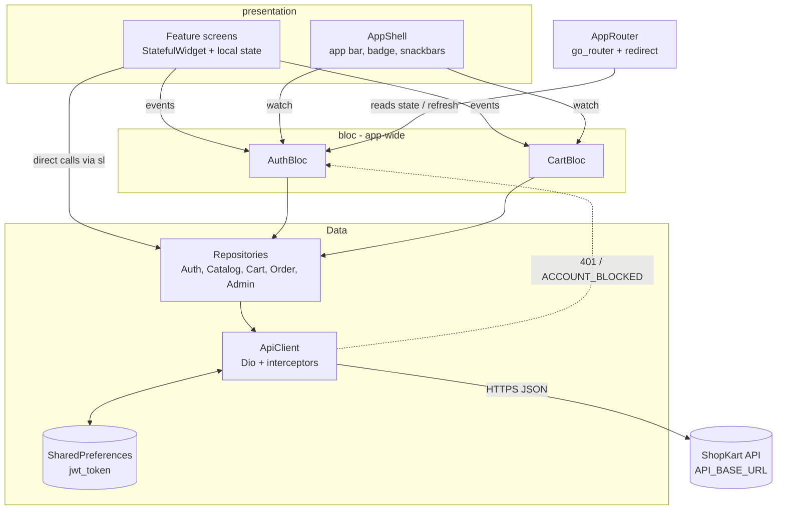
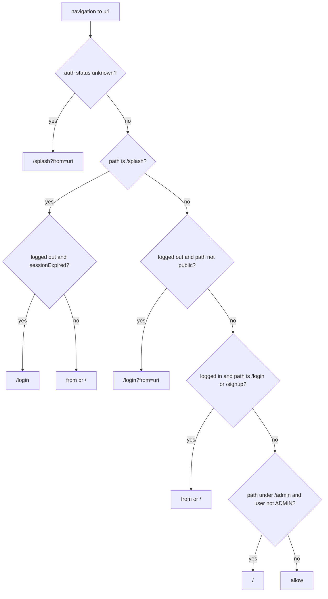
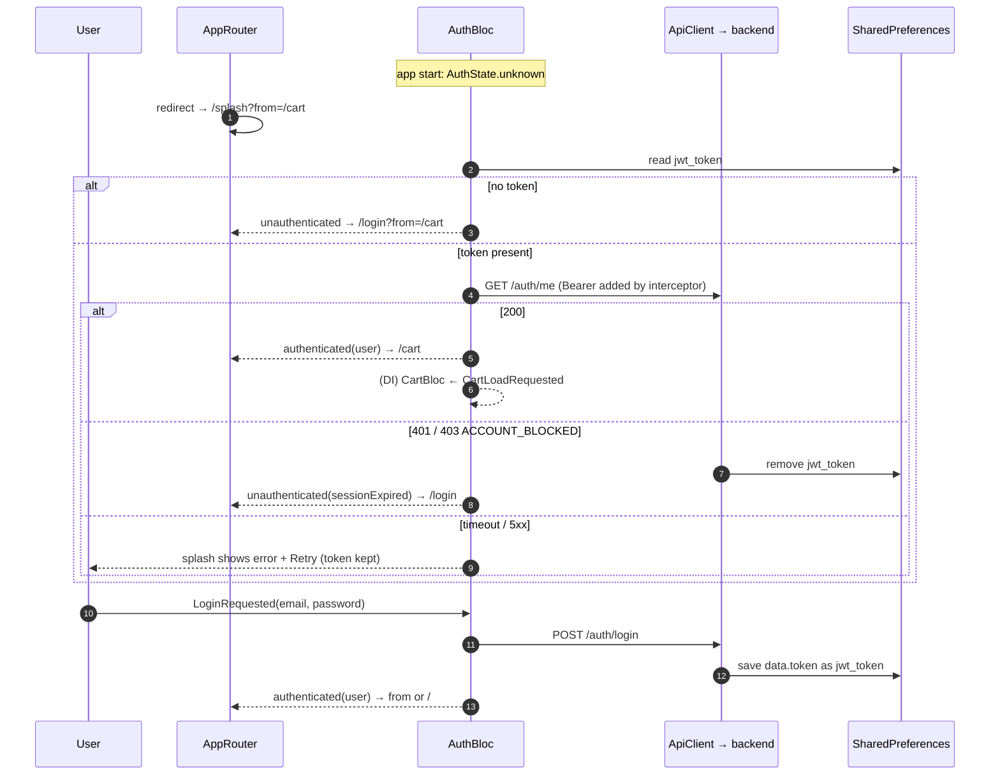

# ShopKart Frontend

The Flutter **web** client for ShopKart. One app serves both shoppers (browse, cart, checkout, orders, profile) and admins (dashboard, catalog, CSV import, orders, users). It uses `flutter_bloc`, Dio, `go_router`, `get_it` and `shared_preferences`.

> Part of the ShopKart monorepo. See the [root README](../README.md) for the whole system and the [backend README](../backend/README.md) for every endpoint this app calls.

---

## Contents

- [At a glance](#at-a-glance)
- [Theme and design system](#theme-and-design-system)
- [Features and screens](#features-and-screens)
- [Project structure](#project-structure)
- [Architecture](#architecture)
- [Dependency injection](#dependency-injection)
- [State management](#state-management)
- [Routing and guards](#routing-and-guards)
- [Authentication flow](#authentication-flow)
- [API client and error handling](#api-client-and-error-handling)
- [Repositories (API services)](#repositories-api-services)
- [Models](#models)
- [Utilities and shared components](#utilities-and-shared-components)
- [Dependencies](#dependencies)
- [Setup, run and build](#setup-run-and-build)
- [Debugging and troubleshooting](#debugging-and-troubleshooting)
- [Known limitations and discrepancies](#known-limitations-and-discrepancies)

---

## At a glance

| Item | Value |
|------|-------|
| Package name | `shopkart_client` ([`pubspec.yaml`](pubspec.yaml)) |
| Dart SDK | `^3.13.2` |
| Target | **Web only.** There are no `android/`, `ios/` or desktop folders, and [`lib/core/web/browser_files.dart`](lib/core/web/browser_files.dart) imports `package:web` and `dart:js_interop`. |
| Backend URL | `--dart-define=API_BASE_URL=<…/api>`. **Required, with no default** |
| URL strategy | Path URLs (`usePathUrlStrategy()`), so `/products/123`, not `/#/products/123` |
| Session storage | JWT in `SharedPreferences` under key `jwt_token` (browser `localStorage`) |
| Money | Integer paise from the server, formatted as `₹1,29,999.00` |
| Tests | None, by project decision. Check with `flutter analyze` + click-through |

---

## Theme and design system

The look of the app lives in [`lib/core/theme/`](lib/core/theme/). Screens never hard-code colours or font sizes. They read them from the theme.

| File | What it holds |
|------|---------------|
| [`app_theme.dart`](lib/core/theme/app_theme.dart) | `AppTheme.light()` and `AppTheme.dark()`. Material 3, `ColorScheme.fromSeed` with the indigo seed `#3949AB` and an amber secondary. Component themes for buttons, inputs, cards, chips, snackbars, dialogs and navigation. Both `MaterialApp`s use `ThemeMode.system`, so dark mode follows the OS. There is no toggle and no saved preference |
| [`app_tokens.dart`](lib/core/theme/app_tokens.dart) | Spacing, radius, breakpoints, widths and sizes (table below), plus the `context.isPhone` / `isTablet` / `isDesktop` helpers and `context.pagePadding` |
| [`status_colors.dart`](lib/core/theme/status_colors.dart) | `StatusColors`, a `ThemeExtension` with light and dark sets of foreground/background tones |

| Token class | Values |
|-------------|--------|
| `AppSpacing` | xs 4, sm 8, md 12, lg 16, xl 24, xxl 32, xxxl 48 |
| `AppRadius` | sm 8, md 12, lg 20, pill 999 |
| `AppBreakpoints` | tablet 600, desktop 1024. Phone is below 600, tablet is 600 to 1024, desktop is **above 1024** |
| `AppWidths` | content 1200, form 760, auth 440, narrow 960 |
| `AppSizes` | minTap 40, buttonHeight 44 |

### StatusColors

`StatusColors.of(context)` returns six tones, each a `StatusTone(fg, bg)`: `success`, `warning`, `danger`, `info`, `violet` and `neutral`. Three mappers turn server values into a tone:

| Mapper | Mapping |
|--------|---------|
| `stock(stockStatus)` | `low_stock` → warning, `out_of_stock` → danger, anything else → success |
| `order(status)` | `PENDING` → warning, `CONFIRMED` → info, `SHIPPED` → violet, `DELIVERED` → success, `CANCELLED` → danger, else neutral |
| `payment(paymentStatus)` | `PAID` → success, `UNPAID` / `REFUNDED` / other → neutral |

### Rules for screens

- No `Colors.green/orange/red/white/...`, no `Color(0x...)`, no raw `fontSize:`, no `hintColor`, no `OutlineInputBorder()` or `isDense` overrides in `lib/presentation`. Use theme roles (`Theme.of(context).colorScheme`, `textTheme`), `StatusColors` and the tokens.
- The one exception is the initials fallback in `ProductThumbnail`, which keeps its name-hashed colour and white text.
- Every `IconButton` has a `tooltip`. Every snackbar goes through `showAppSnack`.

---

## Features and screens

| Area | Route | Screen file | What it does | Backend calls |
|------|-------|-------------|--------------|---------------|
| Splash | `/splash` | [`splash_screen.dart`](lib/presentation/components/splash_screen.dart) | Shown while the session is restored. If the server can't be reached (for example a cold start), shows the error and a **Retry** button | `GET /auth/me` (via AuthBloc) |
| Login | `/login` | [`login_screen.dart`](lib/presentation/features/auth/login_screen.dart) | Email + password. Returns to the `?from=` path afterwards | `POST /auth/login` |
| Sign up | `/signup` | [`signup_screen.dart`](lib/presentation/features/auth/signup_screen.dart) | Name, email, password. Always creates a `USER` | `POST /auth/signup` |
| Storefront | `/` | [`storefront_screen.dart`](lib/presentation/features/storefront/storefront_screen.dart) | Product grid (24 per page), search (400 ms debounce), category chips, sort (newest / price ↑ / price ↓), pager, stock badges | `GET /products`, `GET /categories` |
| Product detail | `/products/:id` | [`product_detail_screen.dart`](lib/presentation/features/storefront/product_detail_screen.dart) | Image or thumbnail, price, category, description, stock badge. **Add to cart** is disabled when out of stock. Guests are sent to `/login?from=/products/:id` | `GET /products/:id` |
| Cart | `/cart` | [`cart_screen.dart`](lib/presentation/features/cart/cart_screen.dart) | Lines with −/+/remove, flags for unavailable / out-of-stock / insufficient-stock lines, server subtotal. **Checkout** is disabled while any line is flagged | `/cart` endpoints |
| Checkout | `/checkout` | [`checkout_screen.dart`](lib/presentation/features/checkout/checkout_screen.dart) | Address form (validated like the server), Cash on Delivery or **Pay now** (with a "demo payment" confirm dialog), order summary | `POST /orders` |
| My orders | `/orders` | [`orders_screen.dart`](lib/presentation/features/orders/orders_screen.dart) | Paged history, newest first | `GET /orders` |
| Order detail | `/orders/:id` | [`order_detail_screen.dart`](lib/presentation/features/orders/order_detail_screen.dart) | Items, address, payment, status history, **Cancel** while `PENDING`. `?placed=1` shows an "Order placed" banner | `GET /orders/:id`, `POST /orders/:id/cancel` |
| Profile | `/profile` | [`profile_screen.dart`](lib/presentation/features/profile/profile_screen.dart) | Account info, change name, change password (current password required) | `GET/PATCH /users/me`, `PATCH /users/me/password` |
| Admin dashboard | `/admin` | [`admin_screen.dart`](lib/presentation/features/admin/admin_screen.dart) | Paid revenue, order counts per status, low-stock list (links to edit), 5 recent orders (links to detail), links to every admin area | `GET /admin/stats` |
| Admin orders | `/admin/orders` | [`admin_orders_screen.dart`](lib/presentation/features/admin/orders/admin_orders_screen.dart) | All orders with status filter chips and paging | `GET /admin/orders` |
| Admin order detail | `/admin/orders/:id` | [`admin_order_detail_screen.dart`](lib/presentation/features/admin/orders/admin_order_detail_screen.dart) | Customer, items, address, payment, history, and buttons for the next allowed statuses (cancel asks for confirmation) | `GET /admin/orders/:id`, `PATCH …/status` |
| Admin users | `/admin/users` | [`admin_users_screen.dart`](lib/presentation/features/admin/users/admin_users_screen.dart) | Search (on submit), paging, **New user** dialog with a role, Make admin / Make user, Block / Unblock. The menu is disabled on your own row | `/admin/users` endpoints |
| Admin products | `/admin/products` | [`admin_products_screen.dart`](lib/presentation/features/admin/products/admin_products_screen.dart) | All products, including inactive, with search (on submit), All/Active/Inactive filter, category filter and paging | `GET /admin/products`, `GET /admin/categories` |
| New / edit product | `/admin/products/new`, `/admin/products/:id` | [`product_form_screen.dart`](lib/presentation/features/admin/products/product_form_screen.dart) | Full form. Price is typed in rupees and sent as paise. The **Active** switch is the soft delete | `POST` / `GET` / `PUT /admin/products…` |
| CSV import | `/admin/products/import` | [`product_import_screen.dart`](lib/presentation/features/admin/products/product_import_screen.dart) | Template preview + **Download template**, pick a `.csv` (≤ 1 MB, checked in the browser), import, and a per-row error table | `GET …/import/template`, `POST …/import` |
| Categories | `/admin/categories` | [`admin_categories_screen.dart`](lib/presentation/features/admin/categories/admin_categories_screen.dart) | List with product counts, create, rename and delete. Deleting a category that has products shows the server's message | `/admin/categories` endpoints |

The **app bar** ([`app_shell.dart`](lib/presentation/layout/app_shell.dart)) wraps every page except splash, login and signup:

- **Guest:** **Log in** and **Sign up** buttons.
- **Logged in:** a cart icon with an item-count badge, plus an account menu with name/email/role, **Profile**, **My orders** and **Log out**.
- **Admin:** an extra **Admin** button.

The shell also shows the cart snackbars, such as "Added to cart" with a **View cart** action.

What the revamp changed per area (behaviour, routes and server calls are unchanged):

- **Shell:** a branded header (`BrandMark`, links to `/`), the cart icon with a `Badge`, an account menu with an avatar, name, email and role chip. Guests get Log in and Sign up, which collapse to an account icon on phones. On `/admin` and `/admin/*` the shell wraps the page in `AdminLayout`: a `NavigationRail` (extended on desktop, compact on tablet) or an `AdminDrawer` on phones.
- **Auth:** login and signup share `AuthLayout` (a centred card, 440 wide).
- **Storefront:** a heading, a sticky filter bar (search, sort menu, category chips) and a responsive grid of `ProductCard`s. A skeleton grid shows on the first load.
- **Product detail:** two columns on tablet and desktop (image, then info and a buy box with price, stock and **Add to cart**), stacked on phones.
- **Cart and checkout:** a `StepIndicator` (display only). Desktop shows a summary panel beside the content. Phones show a bottom summary bar. Flagged cart lines get an error outline and an inline banner.
- **Orders:** cards with a status chip. Order detail uses `SectionCard`s and an `OrderTimeline`.
- **Profile:** an avatar header and section cards.
- **Admin dashboard:** a stat-card grid coloured by `StatusColors`, a low-stock list and recent orders.
- **Admin lists (orders, users, products, categories):** a table with a column header when the content is at least `kAdminTableMinWidth` wide, and stacked cards otherwise. Product form and CSV import use section cards.
- **Not found:** `NotFoundScreen`, used by the router's `errorPageBuilder`.

---

## Project structure

```text
frontend/
├── pubspec.yaml
├── analysis_options.yaml        # flutter_lints; excludes build/ and web/
├── web/                         # index.html ($FLUTTER_BASE_HREF), manifest.json, icons
└── lib/
    ├── main.dart                # config check → path URLs → DI → ShopKartApp
    ├── core/
    │   ├── di/injection_container.dart   # get_it registrations + Auth→Cart wiring
    │   ├── network/api_client.dart       # Dio, base URL, token + session interceptors, ApiException
    │   ├── router/app_router.dart        # go_router routes, redirect guards, session-end navigation
    │   ├── theme/                        # app_theme.dart, app_tokens.dart, status_colors.dart
    │   ├── utils/money.dart              # formatPaise, rupeesToPaise, paiseToRupeesInput
    │   ├── utils/date_format.dart        # formatOrderDate, formatOrderDateTime
    │   └── web/browser_files.dart        # Blob download + file picker (web only)
    ├── bloc/
    │   ├── auth/  auth_bloc.dart, auth_event.dart, auth_state.dart
    │   └── cart/  cart_bloc.dart, cart_event.dart, cart_state.dart
    ├── models/                  # user, category, product, cart, order, stats (fromJson, Equatable)
    ├── repositories/            # auth, catalog, cart, order, admin: one method per endpoint
    └── presentation/
        ├── layout/              # app_shell.dart, admin_layout.dart (rail + drawer)
        ├── components/          # shared widgets: admin_list, app_snack, brand_mark, confirm_dialog,
        │                        #   empty_state, error_state, loading_skeleton, not_found_screen,
        │                        #   order_sections, order_timeline, page_container, page_header, pager,
        │                        #   price_text, product_thumbnail, section_card, splash_screen,
        │                        #   status_banner, status_pill, step_indicator, stock_badge
        └── features/
            ├── auth/            # login, signup, auth_layout.dart
            ├── storefront/      # storefront grid, product_card.dart, product detail
            ├── cart/  checkout/  orders/  profile/
            └── admin/           # admin_screen (dashboard), categories/, products/, orders/, users/
```

---

## Architecture



Two patterns coexist on purpose (an MVP decision recorded in the planning notes):

1. **App-wide state uses BLoC.** Session (`AuthBloc`) and cart (`CartBloc`) are needed by many screens and by the app bar.
2. **Screen-local state uses plain `StatefulWidget` + `setState`.** Storefront, orders, checkout, profile and all admin screens call repositories directly through the `get_it` locator (`sl<…>()`). They keep `_loading` / `_error` / result fields and check `mounted` before `setState`. Only the storefront also discards stale responses, using a request sequence number (`_requestSeq`).

---

## Dependency injection

[`lib/core/di/injection_container.dart`](lib/core/di/injection_container.dart) registers lazy singletons on `GetIt.instance` (exported as `sl`):

| Registration | Depends on |
|--------------|------------|
| `SharedPreferences` | (awaited before registration) |
| `ApiClient` | `SharedPreferences` |
| `AuthRepository` | `ApiClient`, `SharedPreferences` |
| `AdminRepository`, `CatalogRepository`, `CartRepository`, `OrderRepository` | `ApiClient` |
| `AuthBloc` | `AuthRepository` |
| `CartBloc` | `CartRepository` |
| `AppRouter` | `AuthBloc` |

It also wires two cross-cutting links:

- `AuthBloc.stream` → `CartBloc`: **authenticated** triggers `CartLoadRequested`, and **unauthenticated** triggers `CartCleared`. The cart badge therefore follows the login state.
- `ApiClient.onUnauthorized = () => AuthBloc.add(SessionExpired())`. This is set after construction to avoid a constructor cycle.

---

## State management

### AuthBloc ([`lib/bloc/auth/`](lib/bloc/auth/))

All events run through **one sequential handler** (`asyncExpand`), so a logout and an expiry can never interleave.

| Event | Effect |
|-------|--------|
| `AppStarted` | If no token, emits `unauthenticated`. Otherwise calls `GET /auth/me`. Success emits `authenticated(user)`. `401` / `ACCOUNT_BLOCKED` emits `unauthenticated(sessionExpired: true)`. A network error, timeout or 5xx emits `unknown(errorMessage)` and **keeps the token**, so the splash shows Retry |
| `LoginRequested` / `SignupRequested` | `loading`, then `authenticated(user)` or `error(message)` |
| `LogoutRequested` | `POST /auth/logout` (best effort), deletes the token, emits `unauthenticated` |
| `SessionExpired` | Only if currently authenticated: emits `unauthenticated(sessionExpired: true)` |
| `UserUpdated(user)` | Replaces the user after a profile change. Ignored if not authenticated or if the id differs |

`AuthState` has `status` (`unknown | loading | authenticated | unauthenticated | error`), `user`, `errorMessage` and `sessionExpired`.

### CartBloc ([`lib/bloc/cart/`](lib/bloc/cart/))

This handler is also sequential, so rapid taps are applied in order.

| Event | Effect |
|-------|--------|
| `CartLoadRequested` | `GET /cart` |
| `CartItemAdded(productId, quantity = 1)` | `POST /cart/items`, then the message "Added to cart" |
| `CartQuantityChanged(productId, qty)` | `PATCH /cart/items/:id` |
| `CartItemRemoved(productId)` | `DELETE /cart/items/:id`, then "Removed from cart" |
| `CartCleared` | Reset to the empty state (on logout) |

`CartState` holds:

- `cart`, the `CartModel` from the server.
- `status`.
- `busyProductId`, which disables that line's buttons while a request runs.
- `message`, `messageIsError` and `messageSeq`. `messageSeq` increments so the same message text can show twice.

After a `404` or `409` the bloc re-fetches the cart, so the UI matches the server. The app never computes prices, subtotals or stock limits itself. It shows only what the server returned.

---

## Routing and guards

[`lib/core/router/app_router.dart`](lib/core/router/app_router.dart) uses `GoRouter` with `refreshListenable` bound to `AuthBloc.stream`. Every route uses a `NoTransitionPage`.

| Route | Public? | Notes |
|-------|---------|-------|
| `/splash` | — | Shown while `AuthStatus.unknown` |
| `/login`, `/signup` | yes | Redirect to `from` (or `/`) when already logged in |
| `/` and `/products/:id` | yes | Inside `AppShell` |
| `/cart`, `/checkout`, `/orders`, `/orders/:id`, `/profile` | no | Inside `AppShell` |
| `/admin`, `/admin/orders`, `/admin/orders/:id`, `/admin/users`, `/admin/categories`, `/admin/products`, `/admin/products/new`, `/admin/products/import`, `/admin/products/:id` | no, **ADMIN** | Inside `AppShell`. Non-admins are redirected to `/` |
| anything else | — | "Page not found" with a **Go home** button |

The `redirect` runs these rules in order:



- `from` is only honoured when it is a same-app path (it starts with `/` but not `//`). This prevents open redirects.
- The admin guard is **cosmetic**. The API enforces admin access on every `/api/admin/*` call.
- When an **authenticated** session becomes **unauthenticated**, `AppRouter` navigates explicitly:
  - After an expiry on a private page, it goes to `/login?from=<current>`.
  - Otherwise it goes to `/login`.

---

## Authentication flow



---

## API client and error handling

[`lib/core/network/api_client.dart`](lib/core/network/api_client.dart)

- **Base URL:** `static const baseUrl = String.fromEnvironment('API_BASE_URL')`. If the value doesn't parse into a URL with a scheme and a host, `main()` shows a **"Configuration error"** screen instead of the app.
- **Dio options:** 30 s connect timeout and 60 s receive timeout, which allows for a Render cold start. JSON headers.
- **Request interceptor:** adds `Authorization: Bearer <jwt_token>` to every request except `/auth/login` and `/auth/signup`.
- **Error interceptor:** if a request **that carried a token** gets `401`, or `403` with `code: ACCOUNT_BLOCKED`, it deletes the token and calls `onUnauthorized`, which fires `SessionExpired`. The exception is `/auth/logout`, which only deletes the token.
- **Debug logging:** in debug builds, a `LogInterceptor` logs method/URL/status only, with no headers or bodies.

`ApiException` is the single error type the UI handles:

| Field | Source |
|-------|--------|
| `message` | server `message`, else `"Server error occurred"`, or `"Cannot reach the server. Please try again."` when there is no response |
| `statusCode` | HTTP status |
| `code` | server `code` (e.g. `INSUFFICIENT_STOCK`) |
| `details` | server `errors` array (CSV row errors, stock problems) |
| `isUnauthorized` / `endsSession` | `401` / `401 or ACCOUNT_BLOCKED` |

The backend returns `400 INVALID_CURRENT_PASSWORD` for a wrong current password, **not 401**, precisely so this interceptor does not log the user out.

---

## Repositories (API services)

Each method wraps one endpoint. Each one catches `DioException` and rethrows it as `ApiException`. Paths are relative to `API_BASE_URL`.

| Repository | Methods → endpoint |
|------------|--------------------|
| [`AuthRepository`](lib/repositories/auth_repository.dart) | `signup` → `POST /auth/signup` (stores token) · `login` → `POST /auth/login` (stores token) · `getCurrentUser` → `GET /auth/me` (returns `null` if no token) · `getProfile` → `GET /users/me` · `updateName` → `PATCH /users/me` · `changePassword` → `PATCH /users/me/password` · `logout` → `POST /auth/logout` then always removes the token |
| [`CatalogRepository`](lib/repositories/catalog_repository.dart) | **Public:** `getStoreProducts` (page, limit = 24, q, categoryId, sort) → `GET /products` · `getStoreProduct` → `GET /products/:id` · `getStoreCategories` → `GET /categories` · **Admin:** `getCategories`, `createCategory`, `renameCategory`, `deleteCategory` → `/admin/categories…` · `getProducts` (page, limit = 20, q, status, categoryId) → `GET /admin/products` · `getProduct`, `createProduct`, `updateProduct` → `/admin/products…` · `getImportTemplate` → `GET /admin/products/import/template` · `importProducts(csvText)` → `POST /admin/products/import` as `text/csv` |
| [`CartRepository`](lib/repositories/cart_repository.dart) | `getCart`, `addItem`, `updateQuantity`, `removeItem` → `/cart`, `/cart/items/:productId` |
| [`OrderRepository`](lib/repositories/order_repository.dart) | `placeOrder(address, paymentMethod)` → `POST /orders` · `getMyOrders(page)` · `getOrder(id)` · `cancelOrder(id)` → `POST /orders/:id/cancel` · **Admin:** `getAdminOrders(page, status)` · `getAdminOrder(id)` · `updateOrderStatus(id, status)` → `PATCH /admin/orders/:id/status` |
| [`AdminRepository`](lib/repositories/admin_repository.dart) | `getStats` → `GET /admin/stats` · `getUsers(page, q)` · `createUser(...)` · `setUserRole(id, role)` · `setUserBlocked(id, isBlocked)` · `ping` → `GET /admin/ping` (**defined but not called by any screen**) |

For request and response bodies, see the [backend API reference](../backend/README.md#api-reference).

---

## Models

All models live in [`lib/models/`](lib/models/), extend `Equatable` and are built with hand-written `fromJson` factories. They use tolerant defaults for missing fields. No code generation is used.

| Model | Fields (abridged) | Notes |
|-------|-------------------|-------|
| `UserModel`, `UserPage` | `id, name, email, role, createdAt, isBlocked` | `isAdmin` getter. `isBlocked` only comes from admin endpoints |
| `CategoryModel` | `id, name, productCount` | `productCount` only comes from the admin list |
| `ProductModel`, `ProductPage` | `id, name, description, price (paise), stock, stockStatus, categoryId, categoryName, imageUrl, isActive` | `stockStatus` is computed by the server (`in_stock`, `low_stock`, `out_of_stock`) |
| `CartModel`, `CartItemModel` | `items, itemCount, subtotal, hasIssues` / `productId, price, quantity, stock, stockStatus, lineTotal, issue` | `canIncrease` = no issue and `quantity < stock` |
| `OrderModel`, `OrderSummaryModel`, `OrderPage`, `OrderItemModel`, `ShippingAddress`, `StatusEntry`, `OrderCustomer` | mirror the backend order views | `customer` is only present on admin endpoints. `canCancel` = `PENDING` |
| `DashboardStats`, `LowStockItem` | `paidRevenue, paidOrders, totalOrders, ordersByStatus, lowStockThreshold, lowStockCount, lowStock, recentOrders` | Display only |

[`order_model.dart`](lib/models/order_model.dart) also has display helpers:

- `orderStatusLabel`, `paymentMethodLabel` (`MOCK_PAY` → "Paid online (demo)") and `paymentStatusLabel`.
- `shortOrderId`, which gives `#` followed by the last 8 characters.
- `adminNextStatuses`, which decides which buttons to show. It mirrors the server's transition table, but the server is the authority.

---

## Utilities and shared components

| File | Purpose |
|------|---------|
| [`core/utils/money.dart`](lib/core/utils/money.dart) | `formatPaise(129900)` → `₹1,299.00` with Indian grouping. `rupeesToPaise('1299.5')` → `129950` (null if invalid or zero, max 8 integer digits, 2 decimals). `paiseToRupeesInput`. Integer maths only |
| [`core/web/browser_files.dart`](lib/core/web/browser_files.dart) | `downloadTextFile` (Blob + anchor) and `pickTextFile` (hidden `<input type=file>`, rejects > 1 MB) for CSV import |
| [`core/utils/date_format.dart`](lib/core/utils/date_format.dart) | `formatOrderDate` (`dd Mon yyyy`) and `formatOrderDateTime` (adds `HH:mm`) |

Shared widgets in [`presentation/components/`](lib/presentation/components/):

| Widget | Purpose |
|--------|---------|
| `PageContainer` | Max content width, responsive padding, optional scroll |
| `PageHeader` | Title, optional subtitle, actions and back link |
| `EmptyState` / `ErrorState` | Icon, title, message and optional action / error message with a **Retry** button |
| `SkeletonBox`, `ProductGridSkeleton`, `ListSkeleton`, `DetailSkeleton` | Hand-built loading placeholders (no shimmer package) |
| `SectionCard` | Titled card used for form and detail sections |
| `Pager` | Previous / next icon buttons with tooltips and the "Page X of Y" text |
| `StatusPill`, `OrderStatusChip`, `PaymentStatusChip` | Coloured chips from `StatusColors` |
| `StatusBanner` | Inline info / success / warning / error banner |
| `StockBadge` | Badge from the server's `stockStatus`, coloured by `StatusColors.stock` |
| `PriceText` | Shows a server paise value through `formatPaise`. Never does arithmetic |
| `showConfirmDialog` | Confirm dialog that returns `Future<bool>` |
| `showAppSnack` | The only snackbar helper. Hides the current snackbar first. Supports error style and an action |
| `StepIndicator` | Cart, Checkout, Confirmation steps (display only) |
| `OrderTimeline` | Status history of an order |
| `OrderItemsSection`, `ShippingAddressSection`, `PaymentSection` | Order detail sections shared by the customer and admin screens |
| `AdminListCard`, `AdminTableRow`, `AdminColumn`, `kAdminTableMinWidth` | Admin list rows. Table at 840 px or wider, cards below |
| `BrandMark` | Logo mark and "ShopKart" wordmark |
| `NotFoundScreen` | "Page not found" with a **Go home** button |
| `SplashScreen` | Session restore screen with error and **Retry** |
| [`ProductThumbnail`](lib/presentation/components/product_thumbnail.dart) | Shows `imageUrl` if it is http(s). Otherwise, or on a load error, shows the **initials** on a colour hashed from the product name. `expand: true` fills the available space instead of using a fixed size |

---

## Dependencies

From [`pubspec.yaml`](pubspec.yaml):

| Package | Version | Used for |
|---------|---------|----------|
| `flutter_bloc` | ^9.1.1 | `AuthBloc`, `CartBloc`, `BlocProvider/Listener/Builder` |
| `equatable` | ^3.0.0 | Value equality for events, states and models |
| `dio` | ^5.11.1 | HTTP client + interceptors |
| `go_router` | ^18.1.0 | Declarative routing + redirect guards |
| `shared_preferences` | ^2.5.6 | JWT persistence |
| `get_it` | ^9.3.0 | Service locator (`sl`) |
| `web` | ^1.1.1 | Browser APIs for CSV download/upload |
| `flutter_web_plugins` | SDK | `usePathUrlStrategy()` |
| `flutter_lints` (dev) | ^6.0.0 | Lints for `flutter analyze` |

`flutter_test` is listed as a dev dependency (from the Flutter template), but there is no `test/` folder. That matches the project's no-tests decision.

---

## Setup, run and build

Prerequisites:

- Flutter with Dart ≥ 3.13.2.
- Chrome.
- The backend running locally. See the [backend setup](../backend/README.md#setup-and-local-development).

```bash
cd frontend
flutter pub get

# Port 3000 matches the backend's default CORS_ORIGINS (http://localhost:3000)
flutter run -d chrome --web-port 3000 \
  --dart-define=API_BASE_URL=http://localhost:5000/api
```

If you use another port, add it to `CORS_ORIGINS` in `backend/.env` and restart the API.

Static check:

```bash
flutter analyze
```

Release build:

```bash
flutter build web --release \
  --dart-define=API_BASE_URL=https://<your-backend-host>/api
# Hosting under a sub-path (e.g. GitHub Pages project site):
#   add --base-href /<repo-name>/    (web/index.html uses $FLUTTER_BASE_HREF)
```

The output goes to `build/web/`.

Because the app uses **path URLs**, the static host must serve `index.html` for unknown paths so that deep links like `/products/<id>` load. For GitHub Pages, the plan is to copy `index.html` to `404.html`. That step and the GitHub Pages deploy workflow belong to **Phase 8 and do not exist yet** (see the [root README](../README.md#deployment)).

`API_BASE_URL` is baked in at build time. Changing the backend URL requires a rebuild.

---

## Debugging and troubleshooting

| Symptom | Cause / fix |
|---------|-------------|
| "Configuration error: API_BASE_URL is not set" | Run with `--dart-define=API_BASE_URL=http://localhost:5000/api`. The URL needs a scheme and a host. |
| "Cannot reach the server. Please try again." | Backend not running, wrong URL, or **CORS**. Check the browser console. A CORS failure shows up as a network error because the response has no `Access-Control-Allow-Origin`. Make the dev port match `CORS_ORIGINS`. |
| Stuck on the splash screen with a Retry button | `GET /auth/me` timed out or returned 5xx. The token is kept on purpose. Start or wake the backend and press Retry. |
| Sent to `/login` unexpectedly | Any `401` (expired or invalid token, deleted user) or `403 ACCOUNT_BLOCKED` ends the session. |
| Admin button is missing | The account isn't `ADMIN`. Use `npm run seed:admin` or have an admin change the role, then log in again (or reload). |
| CSV upload says "file is too large" | Checked in the browser (1 MB) before upload. The server enforces the same limit. |
| Deep link 404 after deploying | The static host needs a fallback to `index.html` (see above). |

Tools:

- **Network:** Chrome DevTools → Network shows every API call. Debug builds also print method/URL/status through Dio's `LogInterceptor`.
- **Stored token:** on web, `shared_preferences` keeps the token in `localStorage` (look for the key ending in `jwt_token`). Deleting it and reloading logs you out.
- **Flutter DevTools:** run it from `flutter run` to inspect widgets and BLoC rebuilds.

---

## Known limitations and discrepancies

Behaviour kept on purpose (decision D-26 of the UI revamp):

- Only the storefront discards stale responses. Other lists have no stale-response guard.
- The cart **−** button needs `quantity > 1` (plus the existing issue and busy conditions).
- Name limits are 2 to 50 on signup and profile, and 2 to 80 for the checkout full name.
- `AdminRepository.ping` is defined but not called by any screen.

Uncertain after the UI revamp. These were checked by reading code and `flutter analyze` only. No slice was run in a browser by its executor, so a click-through is still pending:

- Layout at 360, 768 and 1440 px (overflow stripes) on every screen.
- Dark mode appearance of every screen.
- Hover, focus ring and press feedback on product cards.
- Whether the admin tables switch to cards at the right content width next to the rail.
- Screen reader labels (`Semantics`) on the cart badge, product cards and status chips.
- The "Configuration error" card when the app is run without `--dart-define=API_BASE_URL`.

---
